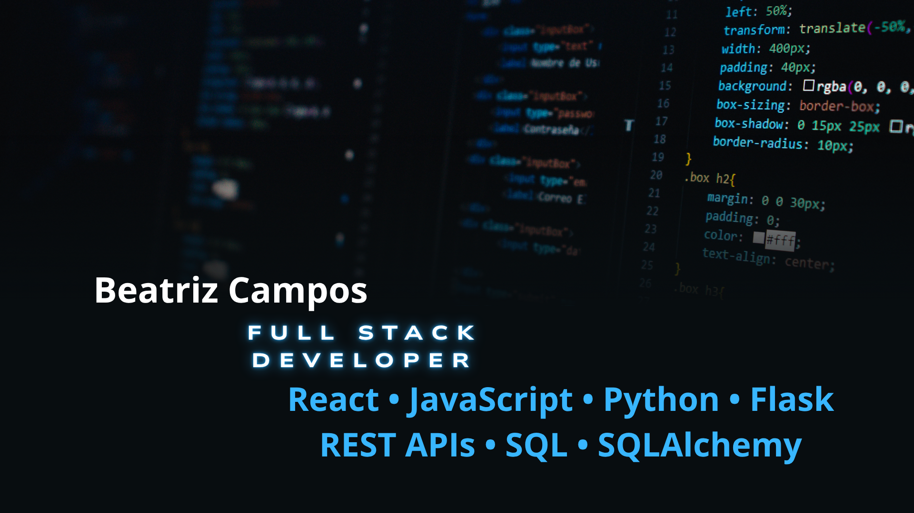

  

# 👋 Hola, soy Beatriz Campos

## 💻 Full Stack Developer

Desarrollo aplicaciones web completas, participando tanto en el **frontend** como en el **backend**, utilizando tecnologías como **JavaScript, TypeScript, React, Next.js, Python, Flask y FastAPI**.

He desarrollado aplicaciones Full Stack en las que he diseñado interfaces modernas y responsivas, implementado **APIs REST**, trabajado con **bases de datos relacionales mediante SQLAlchemy y PostgreSQL**, autenticación mediante **JWT** y entornos de desarrollo con **Docker**.

Además, cuento con especialización en **Full Stack with AI** y **Desarrollo con IA**, integrando herramientas de Inteligencia Artificial y tecnologías **RAG (Retrieval-Augmented Generation)** para desarrollar funcionalidades inteligentes y mejorar las soluciones digitales.

Me interesa especialmente la innovación tecnológica, el desarrollo de aplicaciones escalables y la creación de soluciones funcionales que ofrezcan una excelente experiencia de usuario.

---

## 🚀 Tecnologías

  

**También trabajo con:** SQLAlchemy • REST APIs • JWT • RAG • Inteligencia Artificial

### 🤖 Especialización en IA

* **Full Stack with AI**
* **Desarrollo con IA**
* Integración de herramientas de **Inteligencia Artificial**.
* Desarrollo de asistentes conversacionales y sistemas de recuperación de información mediante **RAG**.

---

## 📌 Proyectos destacados

### 🐱 CatMatch

🔗 **Demo online:** https://catmatch-frontend-next.vercel.app/

🔗 **GitHub:** https://github.com/beatriz24BCN/CatMatch

Aplicación **Full Stack** orientada a facilitar la adopción responsable de gatos mediante un sistema de compatibilidad entre las necesidades de cada animal y el estilo de vida de las personas adoptantes. Incorpora **Matcher**, un asistente conversacional con Inteligencia Artificial que recoge preferencias del usuario y utiliza información contextual para orientar la búsqueda de gatos compatibles. Incluye un pipeline **RAG local basado en Okapi BM25** para recuperar información relevante de guías y documentación de adopción.

**Tecnologías:** Next.js, TypeScript, Python, FastAPI, PostgreSQL, SQLAlchemy, Docker y RAG.

### ⚽ GoalHub

🔗 https://github.com/beatriz24BCN/Predicador-de-Futbol-final

Aplicación **Full Stack** desarrollada con **React**, **Python**, **Flask**, **SQLAlchemy** y **APIs REST**, orientada a aficionados al fútbol. Incluye autenticación de usuarios, estadísticas, comentarios, tienda y sistema de predicciones.

### 🚀 SkillBridge   🚧 Actualmente en desarrollo activo y en constante evolución

🔗 https://github.com/beatriz24BCN/SkillBridge

Aplicación **Full Stack** desarrollada con **React**, **Python**, **Flask**, **SQLAlchemy**, **APIs REST**, **Inteligencia Artificial** y conceptos inspirados en **Blockchain**, orientada al reclutamiento inteligente y la búsqueda de empleo. Incluye asistente de IA, recomendaciones laborales, optimización del CV, preparación de entrevistas, sistema de matching entre candidatos y ofertas y verificación de credenciales mediante **Blockchain**.

### 💆 Zen Massage Booking

🔗 https://github.com/beatriz24BCN/zen-massage-booking

Aplicación **Full Stack** desarrollada con **React**, **JavaScript**, **Python**, **Flask**, **SQLAlchemy** y **APIs REST** para la gestión de reservas, desarrollada con apoyo de **Inteligencia Artificial** y **GitHub Copilot**.

### 🔐 React + Flask + JWT Authentication

🔗 https://github.com/beatriz24BCN/react-flask-hello-JWT-BeitaCam

Aplicación **Full Stack** desarrollada con **React**, **Flask** y autenticación mediante **JWT**, incluyendo gestión de usuarios y comunicación segura mediante **APIs REST**.

---

## 📫 Contacto

📍 Barcelona, España

💼 **LinkedIn:** [Beatriz Campos](https://www.linkedin.com/in/bea-campos-5670a633b)

📧 **Email:** [beatriz24bcn@hotmail.com](mailto:beatriz24bcn@hotmail.com)

---

## 📊 GitHub Stats

  
  

## 🔥 GitHub Streak

  

